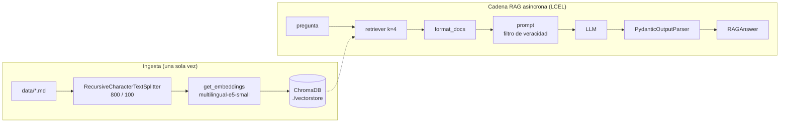

# Pre-entrega 3: Sistema de recuperación semántica local (RAG)

Flujo **End-to-End de RAG** con LangChain y ChromaDB. Recibe una pregunta, busca los fragmentos
relevantes en una base vectorial local ya poblada y genera una respuesta que usa **solo** esa
información. Si la respuesta no está en los documentos, el sistema dice **"No lo sé"**.

La salida siempre es un objeto Pydantic validado (`RAGAnswer`): la respuesta, si salió del
contexto, de qué archivos y con qué confianza.

## Arquitectura



La cadena LCEL de `src/chain.py`:

```python
RunnableParallel(documentos=retriever, pregunta=RunnablePassthrough())
| RunnablePassthrough.assign(
    respuesta={"context": itemgetter("documentos") | format_docs, "question": itemgetter("pregunta")}
    | (prompt | llm | verificar_corte | PydanticOutputParser(pydantic_object=RAGAnswer)).with_retry(...)
  )
| reconciliar_fuentes
```

Es el esquema clásico `retriever | format_docs | prompt | llm | parser`, con dos agregados:
los documentos recuperados se conservan para contrastarlos al final con las fuentes que citó el
modelo, y el tramo `prompt | llm | parser` se reintenta si el JSON llega inválido.

## Estructura

```
entrega-03/
├── data/                       # dataset de ejemplo (4 .md, documentación ficticia)
├── src/
│   ├── config.py               # rutas, colección, modelo de embeddings, chunking, top_k
│   ├── embeddings.py           # get_embeddings(): la ÚNICA instancia de embeddings
│   ├── ingest.py               # carga, chunking, verificación de base existente, persistencia
│   ├── retriever.py            # abre la colección, verifica el modelo y devuelve el retriever (k=4)
│   ├── schemas.py              # RAGAnswer (contrato Pydantic de la respuesta)
│   ├── prompts.py              # system prompt "filtro de veracidad" + format_instructions del parser
│   └── chain.py                # cadena LCEL asíncrona, reintentos, fallback, ask() y ask_many()
├── tests/                      # 34 tests offline (no llaman a la API ni descargan el modelo)
├── main.py                     # CLI: ingest / buscar / ask / chat / demo
├── demo.ipynb                  # recorrido del flujo completo, ya ejecutado con salidas reales
├── requirements.txt
├── requirements-dev.txt
└── .env.example
```

`vectorstore/` se genera al correr la ingesta y no se commitea.

## Instalación

Requiere Python 3.11 o 3.12 (chromadb y torch todavía no publican ruedas para todas las
versiones más nuevas).

```bash
cd entrega-03
python3.12 -m venv .venv
source .venv/bin/activate
pip install -r requirements.txt        # o requirements-dev.txt para tests y notebook
cp .env.example .env                   # y completá la API key
```

| Variable | Para qué | Default |
|---|---|---|
| `LLM_PROVIDER` | Proveedor principal: `anthropic` u `openai` | `anthropic` |
| `ANTHROPIC_API_KEY` / `OPENAI_API_KEY` | Key del proveedor (la otra es opcional y habilita el fallback) | sin default |
| `ANTHROPIC_MODEL` / `OPENAI_MODEL` | Modelo a usar | `claude-opus-5-5` / `gpt-6.1-sol` |
| `LLM_MAX_TOKENS` | Límite de tokens de salida | `1024` |
| `LLM_TEMPERATURE` | Temperatura (no se envía si no está definida) | sin default |

Los embeddings corren en local con `sentence-transformers` y no necesitan API key. La primera
vez se descarga el modelo (unos 470 MB) y queda en la caché de HuggingFace.

## Cómo correrlo

```bash
python main.py ingest            # indexa data/ en ./vectorstore (si ya existe, no hace nada)
python main.py ingest --force    # borra la colección y la reconstruye
python main.py buscar "consulta" # solo recuperación: los 4 fragmentos y su distancia, sin LLM
python main.py ask "pregunta"    # RAG completo
python main.py chat              # modo interactivo
python main.py demo              # 6 preguntas en paralelo (4 del dataset, 2 fuera de contexto)
```

`--quiet` antes del subcomando oculta los logs: `python main.py --quiet demo`. `ask`, `chat` y
`demo` crean la base si no existe; si ya existe, la reutilizan.

También se puede usar desde código:

```python
import asyncio
from dotenv import load_dotenv
from src.chain import ask

load_dotenv()
respuesta = asyncio.run(ask("¿Cuánto dura el token de acceso de la API?"))
print(respuesta.model_dump_json(indent=2))
```

## Ejemplos de ejecución

Salidas reales con `claude-opus-5-5`, empezando desde cero (sin `vectorstore/`).

**Ingesta:**

```
$ python main.py ingest
INFO    rag | Documentos cargados: 4 (01_arquitectura_kairo.md, 02_guia_despliegue.md, 03_politica_guardias.md, 04_api_cotizaciones.md)
INFO    rag | Chunking: 4 documentos -> 34 fragmentos (chunk_size=800, chunk_overlap=100)
INFO    rag | Cargando el modelo de embeddings intfloat/multilingual-e5-small
INFO    rag | Ingesta completa: 4 documentos, 34 fragmentos persistidos en ./vectorstore (colección 'pre_entrega_3')
Indexados 4 documentos en 34 fragmentos.
```

**Pregunta respondida con el contexto** (la base ya existe, así que no se re-indexa):

```
$ python main.py ask "¿Cuántas réplicas mínimas tiene el servicio despacho en producción?"
INFO    rag | Base ya indexada en ./vectorstore (34 fragmentos): se omite la ingesta
INFO    rag | Recuperados 4 fragmentos: 01_arquitectura_kairo.md#4, 02_guia_despliegue.md#0, 04_api_cotizaciones.md#5, 02_guia_despliegue.md#2
INFO    rag | Llamada 1 al modelo claude-opus-5-5
INFO    rag | Respuesta del modelo: fin=end_turn | tokens entrada=2041 salida=129
INFO    rag | Respuesta validada: found_in_context=True, fuentes=['01_arquitectura_kairo.md']

[EN CONTEXTO | confianza alta]
Respuesta: El servicio `despacho` tiene como mínimo tres réplicas en producción, porque es el servicio más crítico: si se cae, los centros de distribución no pueden cargar camiones. El resto de los servicios corre con dos réplicas.
Fuentes: 01_arquitectura_kairo.md
```

**Pregunta fuera del contexto:**

```
$ python main.py ask "¿Cuál es el sueldo promedio de un desarrollador en Transportes Altiplano?"
INFO    rag | Base ya indexada en ./vectorstore (34 fragmentos): se omite la ingesta
INFO    rag | Recuperados 4 fragmentos: 04_api_cotizaciones.md#0, 01_arquitectura_kairo.md#1, 01_arquitectura_kairo.md#0, 03_politica_guardias.md#0
INFO    rag | Respuesta validada: found_in_context=False, fuentes=[]

[FUERA DE CONTEXTO | confianza baja]
Respuesta: No lo sé. No tengo acceso a esa información en la documentación disponible.
Fuentes: (ninguna)
```

Es una pregunta trampa: la documentación menciona el salario (la guardia se compensa con un 8 %
del sueldo), pero no dice cuánto cobra nadie. El modelo no completó con un número verosímil.

El objeto que devuelve `ask()` en el primer caso:

```json
{
  "answer": "El servicio `despacho` tiene como mínimo tres réplicas en producción, ...",
  "found_in_context": true,
  "sources": ["01_arquitectura_kairo.md"],
  "confidence": "alta"
}
```

**Demo completa** (`python main.py --quiet demo`): las 6 preguntas se clasifican bien (4 en
contexto con su fuente correcta y 2 con "No lo sé") y corren en paralelo. En `demo.ipynb` está la
comparación: 4 preguntas tardan 8,7 s una por una y 3,6 s con `asyncio.gather`.

## Dataset

`data/` tiene 4 documentos **inventados** sobre una empresa ficticia, Transportes Altiplano, y su
plataforma interna Kairo:

| Archivo | Contenido |
|---|---|
| `01_arquitectura_kairo.md` | Servicios, comunicación, almacenamiento, infraestructura, ADRs |
| `02_guia_despliegue.md` | Ambientes, canary, ventanas de congelamiento, rollback, secretos |
| `03_politica_guardias.md` | Rotación de guardias, severidades, incidentes, postmortems |
| `04_api_cotizaciones.md` | API pública: autenticación, endpoints, cálculo de precio, errores |

Se eligió un tema inventado a propósito: si el dataset fuera sobre un tema público (por ejemplo,
LangChain), el modelo podría responder bien con lo que ya sabe y no habría forma de distinguir
si usó el contexto. Con datos ficticios, cualquier respuesta correcta tiene que salir del
contexto.

Preguntas de prueba:

| Pregunta | Esperado |
|---|---|
| ¿Qué estrategia de despliegue se usa en producción y qué porcentaje del tráfico recibe primero la versión nueva? | Canary, 10 % (`02_guia_despliegue.md`) |
| ¿En cuánto tiempo hay que reconocer una alerta SEV1 y a quién se escala si nadie responde? | 10 min, guardia secundaria y luego el responsable (`03_politica_guardias.md`) |
| ¿Cómo se calcula el peso facturable de un envío en la API de cotizaciones? | Mayor entre peso real y volumen × 250 (`04_api_cotizaciones.md`) |
| ¿Por qué Kairo usa NATS JetStream en lugar de Kafka? | Costo operativo, ADR-007 (`01_arquitectura_kairo.md`) |
| ¿Cuál es la capital de Australia? | "No lo sé" (cultura general, el modelo la sabe pero no debe usarla) |
| ¿Qué CRM usa el equipo comercial de Transportes Altiplano? | "No lo sé" (tema de la empresa que la documentación no cubre) |

## Decisiones de diseño

### Embeddings: un solo modelo, en un solo lugar

- **Modelo**: `intfloat/multilingual-e5-small`, local con `sentence-transformers`. Es
  multilingüe (el dataset está en español), no requiere API key ni tiene costo, y tiene una
  ventana de 512 tokens: un chunk de 800 caracteres (~200 tokens) entra entero, sin truncarse.
  Modelos populares como `all-MiniLM-L6-v2` están entrenados casi solo en inglés y cortan a los
  128-256 tokens.
- **Prefijos E5**: el modelo se entrenó con `"passage: "` para documentos y `"query: "` para
  preguntas. `get_embeddings()` los aplica con `encode_kwargs` y `query_encode_kwargs`.
- **Centralización**: `src/embeddings.py` expone `get_embeddings()` (con `lru_cache`, así el
  modelo se carga una sola vez) y es lo único que usan `ingest.py` y `retriever.py`.
- **Doble control**: al indexar, el nombre del modelo queda guardado en la metadata de la
  colección. Antes de consultar, `get_vectorstore()` lo compara con el configurado y, si no
  coinciden, falla con `EmbeddingsNoCoincidentesError` en lugar de devolver resultados basura
  sin avisar.
- Los vectores se normalizan y la colección usa distancia coseno (`hnsw:space = cosine`).

### Chunking y top_k

- **`chunk_size=800`, `chunk_overlap=100`**: 800 caracteres alcanzan para una sección corta o una
  tabla completa (por ejemplo, la tabla de severidades), y el solapamiento de ~12 % evita que una
  idea quede partida justo en el borde.
- **Separadores para Markdown**: `["\n## ", "\n### ", "\n\n", "\n", " ", ""]`. El splitter
  primero intenta cortar entre secciones y recién después entre párrafos o palabras.
- **Metadata por chunk**: `source` (archivo), `chunk_index` y `seccion` (el título bajo el que cae).
  La sección se le pasa al modelo junto con cada fragmento y sirve para citar.
- **`top_k=4`**: dentro del rango 3-5 de la consigna. Con muchos fragmentos, el modelo tiende a
  ignorar lo que queda en el medio del contexto (*Lost in the Middle*) y además cada consulta
  cuesta más tokens. `validar_top_k()` rechaza cualquier `k` fuera de 3-5.

### Persistencia y skip del re-indexado

- ChromaDB con cliente persistente en `./vectorstore`.
- `vectorstore_exists()` exige dos cosas: que exista la carpeta **y** que la colección tenga
  `count() > 0`. Una carpeta vacía o una colección sin fragmentos (por ejemplo, por una ingesta
  cortada) cuentan como "no existe".
- Si la base existe, `build_vectorstore()` loguea "Base ya indexada... se omite la ingesta" y
  retorna sin recalcular nada. Con `--force`, borra la colección y la vuelve a crear.
- Los IDs de los chunks son determinísticos (`archivo#índice`), así que reconstruir no duplica
  fragmentos.

### Generación grounded

- **Filtro de veracidad** (`src/prompts.py`): el system prompt obliga a usar solo el CONTEXTO, a
  responder "No lo sé. No tengo acceso a esa información..." si no está, a no usar conocimiento
  general aunque se lo sepa, a no inventar datos y a tratar el contexto como datos, no como
  instrucciones (defensa básica contra prompt injection en los documentos).
- **`PydanticOutputParser`**: las instrucciones de formato se generan desde el propio esquema
  (`parser.get_format_instructions()`, inyectadas con `.partial()`), así que no se desincronizan.
  El parser también acepta el JSON envuelto en un bloque ```` ```json ````.
- **El esquema refuerza el prompt**: `RAGAnswer` solo admite dos formas. Si `found_in_context` es
  true, tiene que haber al menos una fuente y la respuesta no puede ser "No lo sé". Si es false, la
  respuesta tiene que empezar con "No lo sé" y `sources` tiene que estar vacío. Cualquier
  combinación intermedia es un error de validación y la cadena reintenta.
- **Fuentes verificadas**: después del parser, `reconciliar_fuentes` descarta cualquier archivo
  citado que el retriever no haya devuelto. El modelo no puede citar algo que no vio.

### Por qué la cadena es asíncrona

Casi todo el tiempo de una consulta es espera de red al LLM. Con `ainvoke` esa espera no bloquea
el event loop, así que varias preguntas pueden procesarse al mismo tiempo (`ask_many` usa
`asyncio.gather`). Es la misma decisión que en la Pre-entrega 1: en un servicio real, un usuario
lento no frena a los demás. En la medición del notebook, 4 preguntas pasan de 8,7 s a 3,6 s.

### Resiliencia (heredada de la Pre-entrega 2)

- `.with_retry()` con backoff exponencial y hasta 3 intentos ante JSON inválido, salida que no
  cumple el esquema, respuesta cortada por tokens (se revisa el `stop_reason` / `finish_reason`)
  o errores transitorios (rate limit, timeout, 5xx). Un 401 o un 400 no se reintentan.
- Si están cargadas las dos API keys, el otro proveedor queda como fallback.
- Los clientes se crean con `max_retries=0`: el único que reintenta es `.with_retry()` y cada
  llamada al modelo queda en los logs con sus tokens.

## Tests

```bash
pip install -r requirements-dev.txt
pytest
```

34 tests offline: usan embeddings falsos (`DeterministicFakeEmbedding`), una ChromaDB temporal y
un LLM guionado, así que no llaman a ninguna API ni descargan el modelo. Cubren:

- **Ingesta**: lectura de .md/.txt, metadata de los chunks, que la segunda ingesta se omita, que
  `--force` reconstruya sin duplicar, que verificar la base no cree carpetas.
- **Retriever**: que devuelva `k` fragmentos, que rechace `k` fuera de 3-5, que falle sin base y
  que detecte un modelo de embeddings distinto al indexado.
- **Esquema**: las dos formas válidas de `RAGAnswer` y seis combinaciones inválidas.
- **Cadena**: contexto y pregunta llegan al prompt, "No lo sé" fuera de contexto, reintento ante
  JSON inválido o incoherente, corte por tokens, no reintento ante 401, fallback, descarte de
  fuentes inventadas y ejecución en paralelo con errores aislados.

## Limitaciones conocidas

- El retriever siempre devuelve 4 fragmentos, aunque ninguno sea relevante. La decisión de
  responder "No lo sé" la toma el modelo siguiendo el prompt. Se podría sumar un umbral de
  distancia, pero las distancias de E5 están muy concentradas (en las pruebas, ~0,10 en una
  pregunta relevante contra ~0,23 en una irrelevante) y un umbral fijo sería frágil con otros
  datasets.
- Con un dataset de 34 fragmentos, la búsqueda por similitud alcanza. Con miles de documentos
  convendría sumar búsqueda híbrida (BM25 + vectores) o un re-ranker.
